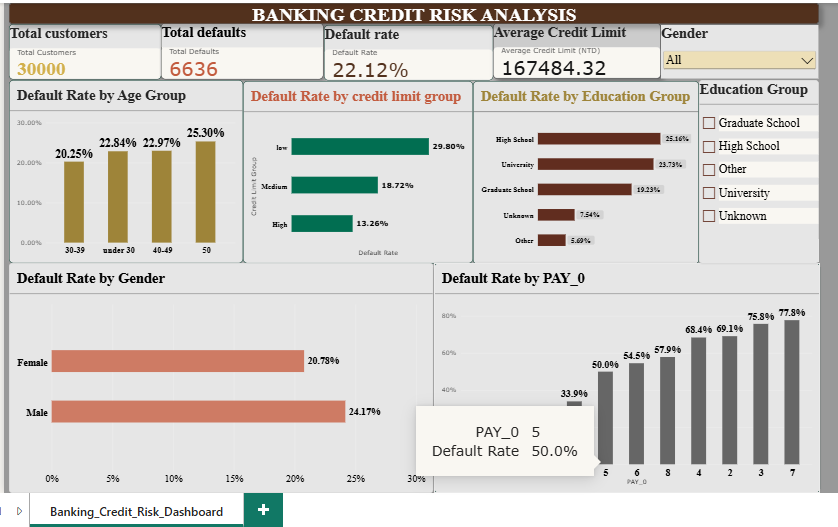

# Banking Credit Risk Analysis | SQL & Power BI

## Project Overview

This project analyzes 30,000 credit card customer records to identify patterns associated with payment defaults. Using Excel, SQL, and Power BI, I explored customer characteristics, repayment history, and credit risk to develop an interactive dashboard that supports data-driven decision-making.

## Tools and Technologies

- **Excel:** Initial data exploration and preparation
- **SQLite (SQL):** Data analysis and querying
- **Power Query:** Data cleaning and transformation
- **DAX:** KPI calculations
- **Power BI:** Interactive dashboard development

## Dataset Source and License

- **Dataset:** Default of Credit Card Clients
- **Creator:** I-Cheng Yeh
- **Source:** [UCI Machine Learning Repository](https://archive.ics.uci.edu/dataset/350/default+of+credit+card+clients)
- **DOI:** https://doi.org/10.24432/C55S3H
- **License:** [Creative Commons Attribution 4.0 International (CC BY 4.0)](https://creativecommons.org/licenses/by/4.0/)

The dataset contains 30,000 credit card customer records from Taiwan, including customer demographics, credit limits, repayment history, and payment default status.

The dataset was used for educational analysis, with additional customer categories and analytical measures created using SQL and Power BI.

**Licensing Note:** The original dataset is licensed under CC BY 4.0. The original SQL code and other project materials are covered by the repository's MIT License, except for third-party materials.

## Project Workflow

1. **Data Preparation:** Explored the dataset in Excel and reviewed data quality.
2. **SQL Analysis:** Used `COUNT()`, `SUM()`, `AVG()`, `GROUP BY`, and `CASE WHEN` to analyze credit risk patterns.
3. **Data Transformation:** Used Power Query to prepare age, education, gender, and credit limit categories.
4. **DAX Measures:** Created measures for total customers, defaults, default rate, and average credit limit.
5. **Dashboard Development:** Built five analytical charts, four KPI cards, and interactive slicers in Power BI.

## Key Performance Indicators

| Metric | Value |
|---|---:|
| Total Customers | 30,000 |
| Total Defaults | 6,636 |
| Overall Default Rate | 22.12% |
| Average Credit Limit | 167,484.32 NTD |

## Key Findings

- **Credit Limit:** Customers in the low credit limit group had a 29.80% default rate, compared with 13.26% in the high credit limit group.
- **Age:** Customers aged 50 and above had a default rate of 25.30%.
- **Gender:** Male customers had a 24.17% default rate, compared with 20.78% for female customers.
- **Repayment History:** Longer payment delays were generally associated with higher default rates.

## Business Recommendations

- Monitor repayment delays to identify accounts that may need early support.
- Investigate differences in default rates across credit limit groups.
- Use dashboard insights to support risk monitoring and further analysis, while ensuring fair lending practices.

## Dashboard Preview

## Limitations and Future Improvements

This project uses historical data and focuses on descriptive analysis rather than predicting individual defaults. The findings show associations, not causation, and may not generalize to current banking populations.

Future improvements could include predictive modeling, advanced SQL analysis, and additional model performance and fairness evaluations.

## Project Files

- **Power BI Dashboard:** `Banking Credit Risk Analysis.pbix`
- **Dashboard Screenshot:** `Banking_Credit_Risk_Dashboard.png.png`
- **SQL Queries:**
  - `01_overall_default_analysis.sql`
  - `02_credit_limit_analysis.sql`
  - `03_education_default_analysis.sql`
  - `04_age_group_default_analysis.sql`
  - `05_repayment_history_analysis.sql`

## Conclusion

This project strengthened my practical skills in SQL, data cleaning, DAX, Power BI, and data visualization while helping me understand how banking data can support business decisions.
